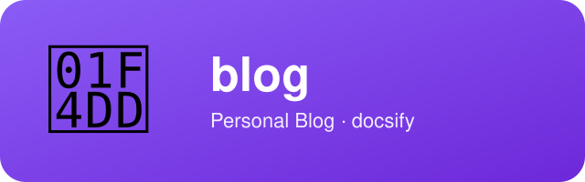

<div align="center">
  

  [](LICENSE.md)
  [](CHANGELOG.md)
  [](#)

  [English](README.md)
</div>

# blog

基于 [docsify](https://docsify.js.org/) 的个人博客「藏经阁」，线上地址：**https://xhqing.github.io/blog**。

## 文章从哪来

两个来源：

- **手写**：直接在 `docs/post/<分类>/` 下新建 Markdown。首行写 `创建于 YYYY-MM-DD<br>`，标题用二级 `##`。
- **自动同步**：`social-agent` 项目里 `docs/articles/` 的文章，由 `.github/workflows/sync-articles.yml` 每 10 分钟拉一次（也可以手动触发），写进 `docs/post/复利与交易/` 这类分类目录。

**同步不看写完没写完**：源仓库里是什么状态，博客上就是什么状态。

同步只认自己写的文章——每篇头部有一行 `<!-- source: … -->` 标记。源文章删除或改了标题，博客上对应那篇会跟着删除或另存；没有标记的手写文章不会被碰。

## 常用命令

```sh
python3 deploy.py                             # 重新生成侧边栏与首页、修首行与公式宏
python3 deploy.py --check                     # 只检查格式，不写文件
python3 scripts/sync_articles.py              # 立刻同步一次 social-agent 的文章
python3 scripts/sync_articles.py --dry-run    # 只看同步计划
python3 scripts/validate.py                   # 仓库自检（CI 跑的就是这个）
```

本地预览：任意静态服务器指向 `docs/` 即可，例如 `python3 -m http.server -d docs 8000`。

## 自动部署配置

仓库里的同步由 GitHub Actions 完成，不需要本机配置。若想在本机手动整理侧边栏与首页，直接跑 `python3 deploy.py` 再提交。

## 版权与署名

Copyright (c) 2021-2026 xhqing and contributors，基于 [MIT License](LICENSE.md) 发布。

署名：使用或引用本项目时，请保留版权声明并注明来源：[blog](https://github.com/xhqing/blog)。